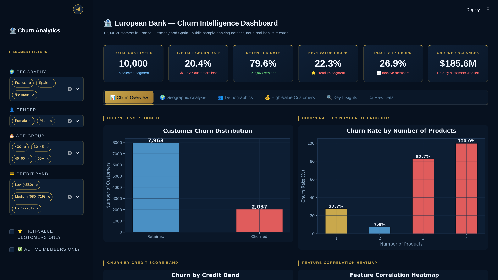

# European Bank — Customer Churn Intelligence Dashboard

**Live app:** https://european-bank-churn-analysis-d4su7yebzrqdkcxrolqwpf.streamlit.app/

An interactive Streamlit dashboard that finds which bank customers are most likely to leave, and why. It covers 10,000 customers in France, Germany and Spain.

Project 2 of 4 · Built during my Data Analyst Internship at Unified Mentor (Jan–Jul 2026).




## The business question

About 1 in 5 customers left the bank. Which customers leave most, and where should a retention team focus first?

## Key findings

- **Age matters most.** Customers aged 46–60 churn at **51.1%**, against 7.6% for under-30s. In Germany this group churns at 67.3%.
- **Germany stands out.** Churn is **32.4%** in Germany, against 16.2% in France and 16.7% in Spain.
- **Inactive customers leave more.** Inactive members churn at **26.9%**, against 14.3% for active members.
- **Two products is the sweet spot.** Churn is 27.7% with one product and 7.6% with two. It jumps to 82.7% with three, though only 326 customers hold three or more.
- **Credit score barely matters.** Churn is between 19.6% and 22.0% in every credit band.

Customers who left held **$185.6M in account balances**. That is money they kept at the bank, not revenue the bank earned.

## How it works

1. **Prepare the data:** drop ID columns, then group customers into age, credit, tenure and balance bands. Flag **high-value** customers: the top 25% by balance or by salary.
2. **Score churn risk** with a simple, transparent points system from 0 to 100:

| Signal | Points |
|---|---|
| Inactive member | 30 |
| Age over 45 | 25 |
| 3 or more products | 25 |
| Zero balance | 10 |
| Credit score under 500 | 10 |

   A score of 55+ is High Risk, 30–54 Medium, under 30 Low. The weights were set by hand, not fitted to the data.
3. **The dashboard** has filters for geography, gender, age group and credit band, plus high-value-only and active-only switches. It has six tabs: churn overview, geographic analysis, demographics, high-value customers, automated insights, and raw data with a CSV download. Every KPI, chart and insight updates with the filters.

## How well it works

The risk score separates customers well, even though nothing was trained:

| Risk tier | Customers | Actually churned |
|---|---|---|
| High (55+) | 1,013 | **71.6%** |
| Medium (30–54) | 4,395 | 16.7% |
| Low (under 30) | 4,592 | 12.6% |

## Limitations

- **Sample data.** This appears to be a widely used public banking dataset, provided for the internship. It is not a real bank's records.
- **One snapshot in time.** There is no history, so the dashboard shows who left, not when or what triggered it.
- **The zero-balance signal points the wrong way.** Zero-balance customers churn *less* (13.8%) than average. Removing that signal would slightly improve the score.
- **Correlation, not cause.** The findings show which groups leave more, not why.

## Run it locally

```bash
git clone https://github.com/Vipsa2207/European-Bank-Churn-Analysis.git
cd European-Bank-Churn-Analysis
pip install -r requirements.txt
streamlit run app.py
```

## Project files

| File | What it is |
|---|---|
| `app.py` | The Streamlit dashboard |
| `European_Bank.csv` | 10,000 customer records |
| `requirements.txt` | Pinned library versions |

## Research paper

I authored a research paper on this project (JETIR paper ID 583670, accepted, not published).

- [Research paper, revised version (PDF)](docs/Research_Paper_Revised.pdf)
- [Stakeholder summary, revised version (PDF)](docs/Stakeholder_Summary_Revised.pdf)

The revised version (November 2026) corrects labels, figures and references in the version submitted to JETIR.

## How I built it

I used AI to help write the Python code. I framed the business question, checked every figure against the data, and wrote the findings.

## Author

**Vipsa Patel** — Data Analyst Intern, Unified Mentor · [LinkedIn](https://www.linkedin.com/in/vipsapatel)
